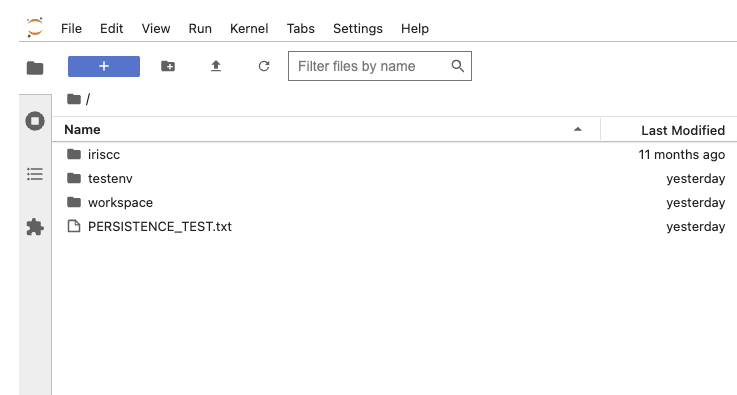
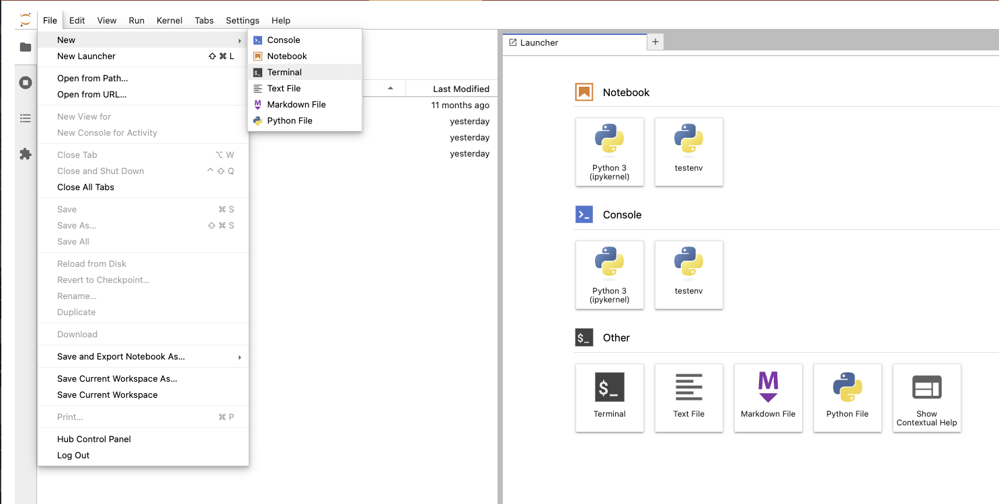
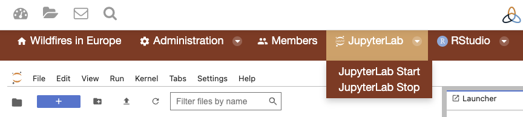

# IRISCC Demo 6 - Wildfires in Europe

*This guide is also available as a PDF next to it in the same folder
(`VRE_home_folder_instructions.pdf`), if you would rather keep or print it.*

## About these notebooks

The tools in this VRE come from different research infrastructures — ACTRIS, IAGOS, ICOS — and from
the FLEXPART modelling group. Each was written by the team that produces the data, for its own
purposes, so they started out quite different from one another in structure, in interface, and in
what they assumed of the reader.

As part of **Demonstrator 6 of IRISCC** they have been harmonised as far as it made sense:

* what to look at is chosen from menus, not by editing code;
* each notebook installs the packages it needs, and only those that are missing;
* each prints its own name, version and date when you run its first cell;
* results are handled the same way everywhere — a folder of its own, emptied at each run, and an
  export cell at the end that packs what you want to keep;
* the parts that are common — clearing outputs, copying to your home, keeping results — are worded
  the same way, so that what you learn in one notebook holds in the next.

Some differences remain, and they are deliberate. Three of the notebooks write nothing to disk,
because they read the data as they plot it; they say so where the export cell would otherwise be.
The scientific content of each tool, and the credit for it, remain with its original authors, who
are named on the landing page.

The aim throughout has been that someone who is not a Python or VRE specialist can work through any
of them without editing code.

## Why

The tools of this VRE are distributed through the **shared workspace**, at
`/workspace/VREFolders/Wildfires_in-Europe/`. That location is right for distribution, but not for
working:

* it is **read-only**, so notebooks that download data or save figures cannot run there;
* it is a FUSE-mounted shared filesystem, noticeably slower than your home directory.

It is read-only on purpose: it holds one known version of every tool, the one that was tested, so
that nobody has to wonder which copy is current. Changes and additions go through
**services@actris-ares.eu** — see *Sharing your work back* at the end.

Your home directory (`/home/jovyan`, shown as `/` at the top of the JupyterLab file browser) is a
persistent volume of your own. **Copy the tool you need into your home directory and work there.**



*The file browser at the root of your home directory. The shared workspace appears inside it as `workspace/`.*

---

## Copying the VRE to your home folder

Copy the whole thing in one go. The tools are meant to be used together — a wildfire case is
usually followed across ACTRIS, IAGOS, ICOS and FLEXPART — and having the complete set means the
landing page works from your copy too, since its links are relative.

### The simplest way: the button in the landing page

Open `IRISCC_home.ipynb` from the shared workspace and press **Copy the VRE to my home folder** in
section 1.2. Three things then happen:

1. everything is copied into `~/Wildfires_in-Europe` — about a minute, with a progress bar;
2. a **link to your own copy of the landing page** appears under the button;
3. clicking it opens your copy in a new tab **and moves the file browser to it**, so you never have
   to navigate there by hand.

Do not skip the third step. From your own copy the buttons open your own notebooks, which you can
run and save; opened from the shared workspace they lead to files that are read-only for everyone
but their owner. Once your copy is open, the tab on the shared page can be closed.

If the link does not open — some browsers block new tabs — use the file browser on the left: the
folder icon at the top takes you to the top level, then enter `Wildfires_in-Europe/` and open
`IRISCC_home.ipynb` from there.

**Checking which copy you are in.** The cell prints, above the button, the folder the page is
running from: under `/workspace/` it is the shared, read-only one, under `/home/jovyan/` it is
yours.

The browser address bar says the same, and even more plainly. Opened through the portal the address
is `iriscc.d4science.org/group/…`; your own copy is on
`jupyterhub.d4science.org/user/<your username>/…`. **If your username is in the address, you are in
your own copy.**

The file browser on the left belongs to the tab, not to the notebook: the new tab opened by the link
starts in your folder, while the tab you came from keeps showing the shared workspace. That is why
it is worth closing it. The folder icon at the top of the browser panel always goes back to the top
level, where `Wildfires_in-Europe/` is your copy.

**If the button itself does not appear, or nothing happens when you press it**, it is the usual
widget problem described further down: clear the outputs, run the cell again, and reload the browser
page if needed. It is most likely to happen when the cell is run a second time. Repeating the copy
is safe — files you already have are kept.

Expect it to take **about a minute**: reading from the shared workspace costs roughly a second per
file whatever its size, and there are a few dozen of them. A progress bar shows how far along it
is, so you can tell it apart from a hung kernel.

Data produced by previous runs is skipped (`data/`, `downloads/`, `outputs/`, `exports/`).

**Files you already have are kept by default.** Pressing the button again is therefore safe — it
fills in what is missing and touches nothing else — but it also means you will not pick up any
improvement made to the shared notebooks in the meantime. To get the current version, choose
*"Overwrite my files with the shared version"* in the dropdown; that replaces your copies,
including any changes you made to them, so move anything you care about somewhere else first.

### From the terminal instead

Open a terminal — *File → New → Terminal*, or the **+** button in the file browser and then
**Terminal** under *Other* — and run:

```bash
cp -r /workspace/VREFolders/Wildfires_in-Europe ~/
chmod -R u+rwX ~/Wildfires_in-Europe
cd ~/Wildfires_in-Europe
```

The `chmod` is not optional: `cp` keeps the permissions of the shared files, which are read-only for
everyone but their owner. Without it JupyterLab opens your own copy with a **"notebook is
read-only"** badge and refuses to save. The button in the landing page does this for you.



*Two ways to open a terminal: the File menu, or the Terminal tile under "Other" in the launcher.*

This copies everything, including the leftovers the button skips, so it takes longer — see the next
section for what can be deleted afterwards. Note also that `cp -r` **overwrites files with the same
name without asking**, unlike the button.

Then open `IRISCC_home.ipynb` from **your** copy — in the file browser it is under
`Wildfires_in-Europe/`, not under `workspace/` — and work from there.

### Freeing up space afterwards

You may find `data/`, `outputs/` or `exports/` folders left over from runs made before the copy.
They can be deleted — every notebook recreates the ones it needs, and empties them at the start of
each run anyway. The copy cell in the landing page skips all of these.

### If you only need one tool

Copying a single folder also works, as long as you take the **whole folder** and not just the
`.ipynb` — most of these notebooks import helper modules or read data files that sit next to them:

| Tool | Command |
|---|---|
| ACTRIS aerosol remote sensing (lidar) | `cp -r /workspace/VREFolders/Wildfires_in-Europe/actris/aerosol_remotesensing ~/` |
| ACTRIS in-situ, quality-controlled (L2) | `cp -r /workspace/VREFolders/Wildfires_in-Europe/actris/aerosol_in_situ/in_situ_L2 ~/` |
| ACTRIS in-situ, near real time (NRT) | `cp -r /workspace/VREFolders/Wildfires_in-Europe/actris/aerosol_in_situ/in_situ_NRT ~/` |
| Explore ACTRIS Facilities | `cp /workspace/VREFolders/Wildfires_in-Europe/actris/ACTRIS_explore_national_facilities.ipynb ~/` |
| ICOS atmospheric data | `cp -r /workspace/VREFolders/Wildfires_in-Europe/icos ~/` |
| IAGOS flight search | `cp -r /workspace/VREFolders/Wildfires_in-Europe/iagos ~/` |
| FLEXPART historical trajectories | `cp -r /workspace/VREFolders/Wildfires_in-Europe/flexpart ~/` |

The next section says what each folder contains and why it has to travel as a whole.

---

## The landing page

`IRISCC_home.ipynb` is the index of the VRE: it describes each tool and links to it.

Its links are **relative**, so they follow the folder they are in. Copy the whole
`Wildfires_in-Europe` folder as above and the page in your copy leads to your own notebooks; opened
from the shared workspace it leads to the shared ones. What does not work is copying the page on its
own, since its links would then point at files that are not next to it.

---

## What each folder contains, and why it must travel together

### `actris/aerosol_remotesensing` — aerosol lidar

```
ACTRIS_aerosol_remote_sensing.ipynb    optical profiles and aerosol typing
ACTRIS_aerosol_typing.ipynb            aerosol typing only
data/                                  the products they download, per run
exports/                               the archives created by the export cell
```

The two notebooks share the same station and date selection and the same plotting code. The first
covers a measurement in full; the second answers only "which aerosol was there", running HIRAC, MAC
and HETEAC-Flex and comparing them, without downloading the optical profiles.

The notebook downloads the optical products and aerosol typing files it plots into a `data/`
subfolder next to itself, and wipes that folder at the start of each run. It therefore needs a
writable directory of its own.

A menu near the top chooses between the full analysis and **aerosol typing only**. The second skips
the optical downloads entirely, so it is faster and lighter on `data/`; the search still runs,
because the typing products are requested per measurement.

`data/` in the shared copy holds someone else's previous run; you can delete it after copying:

```bash
rm -rf ~/aerosol_remotesensing/data
```

### `actris/aerosol_in_situ/in_situ_L2` — quality-controlled in-situ data

```
ACTRIS_aerosol_insitu_L2.ipynb   the notebook
ACTRIS_insitu.py                 the helper module it imports
```

The notebook imports the module, so both are needed. Nothing else: since version 3 the metadata
come straight from the ACTRIS metadata API at every run, and there is no local cache to copy or
keep in sync.

### `actris/aerosol_in_situ/in_situ_NRT` — near real time in-situ data

```
ACTRIS_aerosol_insitu_NRT.ipynb        the notebook
nrt_src/                         helper modules, including nrt_stations.csv
actris_plotting_utilities.py     shared plotting functions
```

This is the folder where copying only the notebook hurts most. Without `nrt_src/` you get an
immediate `ModuleNotFoundError`. Without `nrt_stations.csv` inside it, the notebook *starts
normally* but shows station codes with no names and an empty map — a failure that is easy to mistake
for a bug in the tool.

### `actris/ACTRIS_explore_national_facilities.ipynb`

A standalone notebook: it only queries the ACTRIS API, so the `.ipynb` alone is enough. It sits at
the root of `actris/`, next to the `aerosol_in_situ/` and `aerosol_remotesensing/` folders.

### `icos` — ICOS atmospheric data

```
ICOS_ex1a_atmo_data_L2.ipynb                 Level 2, quality-controlled data
ICOS_ex1a_atmo_data_NRT.ipynb                Near Real-Time data
ICOS_ex1a_atmo_data_L2_two_species.ipynb     Level 2, two products compared
ICOS_ex1a_atmo_data_NRT_two_species.ipynb    Near Real-Time, two products compared
```

The first two combine series of the same product — one gas at several measurement heights. The
`_two_species` variants load two different products for the same station instead, so that CO can be
plotted against CO₂; they are recent and still carry a 0.x version number.

These notebooks are self-contained, so a single `.ipynb` would work on its own. Copying the folder
simply keeps them together. The Level 2 ones require an ICOS Carbon Portal account; the NRT ones do
not, since near real time data are open.

### `iagos` — IAGOS flight search

```
IAGOS_flight_search_download.ipynb   the notebook
src/                                 the fr.aeris.iagos package it imports
environment.yml, pyproject.toml
images/
data/                                archives downloaded by the notebook, emptied at each run
exports/                             the zips made by the export cell, emptied at each run
```

This is a packaged project: the notebook imports the code in `src/`, so the whole folder is
required. `data/` and `exports/` are not — they are recreated at each run, and the copy cell in the
landing page skips them.

IAGOS needs an AERIS account. The notebook asks for it and stores nothing in the package; see
`README.md` inside the folder.

### `flexpart`

A single notebook, `FLEXPART_historical.ipynb`. The folder copy is simply tidier.

---

## Practical notes

**Your home is persistent.** Files there survive stopping and restarting JupyterLab (verified). Note
that the server is stopped and started from the D4Science menu bar — *JupyterLab → JupyterLab Stop*,
then *JupyterLab Start* — not from inside JupyterLab itself. Your home is private to you: nobody
else in the VRE can see it.



*JupyterLab is stopped and restarted from the D4Science menu bar, not from inside JupyterLab.*

**It is network storage (NFS), not a local disk.** Space is shared with the other users of the VRE.
To see what you are using:

```bash
du -sh ~/              # your total
du -sh ~/* | sort -h   # the biggest folders
```

Note that the percentage reported by `df -h` refers to the whole shared NFS export, not to you.

**"Device or resource busy" when deleting.** On NFS, removing files that a process still has open
fails with `Device or resource busy: '.nfs0000...'`. This usually means a kernel is still holding
them. Shut it down — *Kernel → Shut Down Kernel*, or the "Running Terminals and Kernels" panel in
the left sidebar — then delete again.

**`__pycache__` folders.** Python creates these automatically when it imports a helper module, to
cache the compiled bytecode. They can be deleted at any time and are regenerated on the next import.
On this filesystem they also accumulate stale files with numeric suffixes
(`ACTRIS_insitu.cpython-311.pyc.140222456510576`), which are interrupted NFS writes rather than
usable caches. To clean up:

```bash
find ~ -type d -name __pycache__ -exec rm -rf {} + 2>/dev/null
```

**Interactive controls that stop responding.** The dropdowns and buttons in these notebooks are
ipywidgets: part of them lives in the kernel, part in the browser page. When the two get out of
step — usually after re-running a notebook, or running it again in a session that has been open for
a while — controls stop reacting, or a plot area stays blank.

The remedies, in order:

1. *Edit → Clear Outputs of All Cells*, then run again. Do this **before** re-running a notebook,
   not only before saving it;
2. *Kernel → Restart Kernel*, then clear the outputs and run again;
3. **reload the browser page**. Part of the widget state lives in the page itself, and this is
   sometimes the only thing that clears it. It is not a sign that anything is broken.

**"Notebook is read-only", or "Stale file handle".** Both mean the notebook you are running is not
where you think it is. The first appears when you opened it from the shared workspace instead of
your own copy, or when a copy kept the read-only permissions of the shared files — see the `chmod`
above. The second appears when the folder the kernel started in has been replaced since, which
happens when the shared workspace is republished while you have a session open; restarting the
kernel fixes it.

**Where a notebook puts its results, and what survives a re-run.** The tools follow the same
convention:

* what a notebook downloads or produces goes into a folder of its own — `data/` when it downloads
  products (aerosol remote sensing, IAGOS), `outputs/` when it only produces figures (ICOS,
  FLEXPART);
* the archives created by the export cell at the end go into `exports/`;
* **both are emptied when the notebook is run again**, so that repeated runs do not fill up your
  home directory.

The practical consequence: the results of a run last only until the next one. Each notebook ends
with an export cell that packs its figures and tables into a single zip with a download link — use
it before starting a new run on anything you want to keep. Every notebook also has a flag near the
top (`CLEAN_OUTPUTS` or `CLEAN_DATA_FOLDER`) to switch the emptying off.

Three notebooks are different because they write nothing at all: *Explore ACTRIS Facilities* and the
two ACTRIS in-situ ones read their data as they plot and produce interactive Plotly charts. There is
nothing to empty and no export cell — to keep a chart, use the camera icon in its toolbar.

**Missing Python packages.** Each user has their own container, so a notebook that runs for a
colleague may fail for you with `ModuleNotFoundError`. The ACTRIS and ICOS notebooks install what
they need in their first cells. If an import still fails afterwards, restart the kernel and run
again.

---

## Sharing your work back

The shared workspace is **read-only for everyone**: nobody writes into it directly, including you.
That is deliberate — it keeps a single, known version of every tool, so that a notebook opened by a
student is the one that was tested, and no one has to wonder which copy is current.

Your own copy in your home directory is yours to change as you like; it simply stays private.

If you have improved a notebook, written a new one, or produced results worth adding to the VRE,
send them to **services@actris-ares.eu**. They are tested first and then published, which is also
the moment to catch the things that break for other people but not for you — a missing dependency,
a file left out of the copy, a path that only exists on your machine.

Before sending, two things make the review quicker:

* clear the notebook outputs (*Edit → Clear Outputs of All Cells*) — outputs add megabytes to the
  file, and saved widget state shows up as "Error displaying widget: model not found" when someone
  else opens it;
* leave out the downloaded data and the working folders (`data/`, `outputs/`, `exports/`), which are
  recreated at every run.
